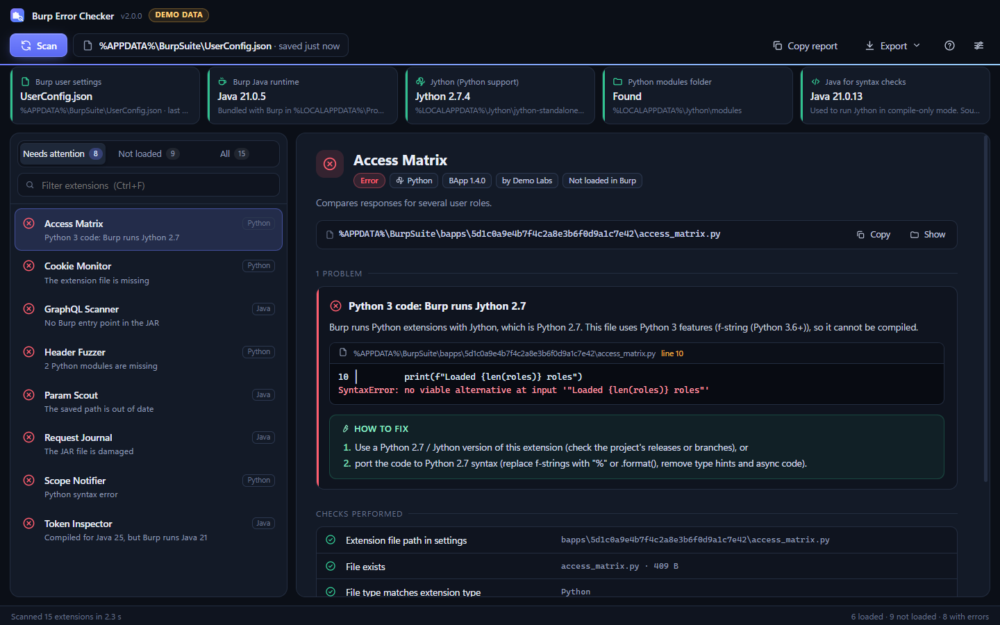
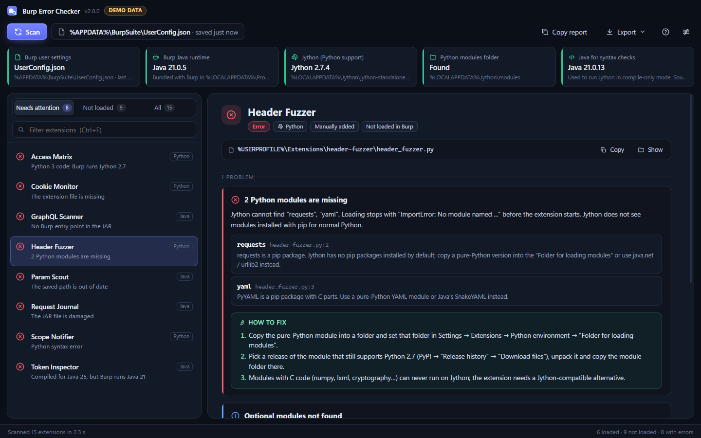
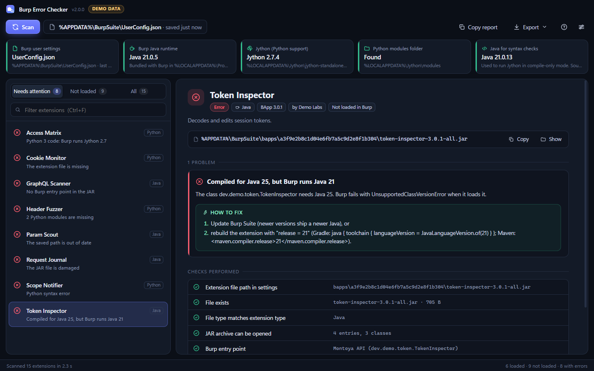
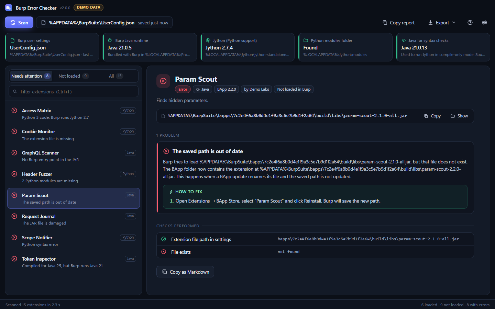
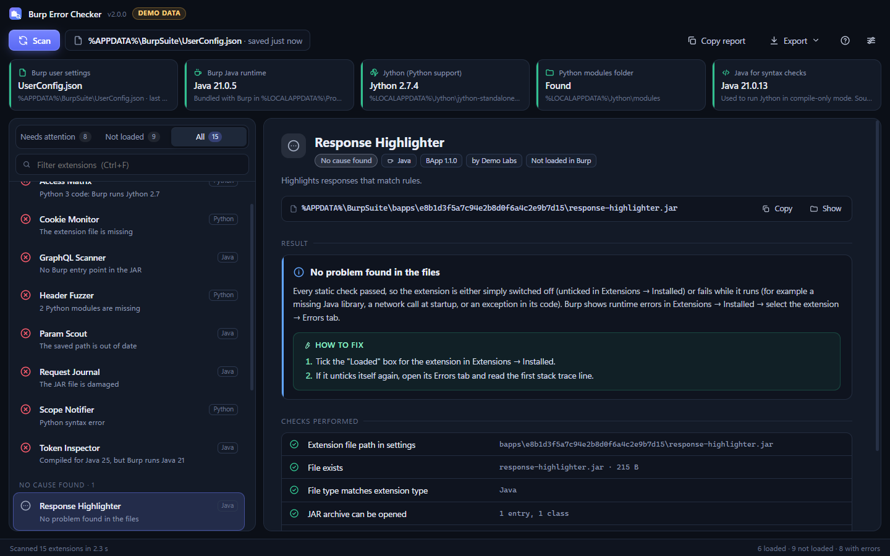

<p align="center">
  
</p>

<h1 align="center">Burp Error Checker</h1>

<p align="center">
  <b>Find out why a Burp Suite extension won't load, and how to fix it.</b><br>
  A Windows desktop app (plus a command-line version) that reads your Burp settings, tests every extension that isn't loaded,<br>
  and explains the real cause in plain English: missing files, broken JARs, Java version mismatches, Python 3 code, missing modules and more.
</p>

<p align="center">
  <a href="../../releases/latest"></a>
  
  
</p>



## Why

When a Burp extension fails, Burp quietly unticks it and prints one stack trace into a small Errors tab, if you happen to look. When ten Python extensions are unticked after an update, a Jython change or a move to a new PC, finding out which ones are really broken (and why) takes a long time.

Burp Error Checker does it in about two seconds, without starting Burp:

- reads the extension list from Burp's `UserConfig.json`,
- runs the same checks Burp would hit while loading each extension,
- shows what is wrong, the exact file and line, and step-by-step instructions to fix it.

It is **read-only and offline**. Nothing in Burp's folders is changed, nothing is sent anywhere, and Python code is only *compiled*, never executed.

## Download

Get the latest version from the [Releases page](../../releases/latest):

| File | What it is |
|---|---|
| `BurpErrorChecker-x.y.z-setup.exe` | Installer with Start menu and desktop shortcuts |
| `BurpErrorChecker-x.y.z-portable.exe` | Single file, no install, run it from anywhere |

No Node.js, Python or anything else is needed. Java is only used to run the Jython syntax check; Burp ships its own Java and the app finds it.

> The executables are not code-signed, so Windows SmartScreen may show "Windows protected your PC" the first time. Click **More info → Run anyway**, or build it yourself from source (see below).

## What it checks

| Area | Checks | Typical message |
|---|---|---|
| **Files** | The saved path exists and is not empty; BApp folders still exist; the path matches the BApp's current entry point | *The saved path is out of date* (a BApp update renamed its JAR) |
| **Java (.jar)** | The archive opens and every class is readable; there is a `burp.BurpExtender` class or a class implementing Montoya's `BurpExtension`; the class-file version fits the Java runtime bundled with your Burp | *Compiled for Java 25, but Burp runs Java 21* |
| **Python (.py)** | The main file and every local module it imports are compiled with **your real Jython JAR**; Python 3 features are named (f-strings, type hints, `async`) | *Python 3 code: Burp runs Jython 2.7* (with file and line) |
| **Python imports** | Every `import` is matched against Jython's standard library, the extension folder and Burp's "Folder for loading modules"; imports inside `try/except` count as optional | *Missing Python module "requests"* |
| **Environment** | Jython is configured, exists, is the *standalone* build and is not damaged; JRuby; module and library folders; Burp's Java version | *This is the plain Jython JAR, not the standalone one* |

If every check passes for an extension that is not loaded, the app says so plainly: the extension is either switched off or fails at runtime, and it tells you where Burp shows that runtime error.

## Screenshots

<table>
  <tr>
    <td width="50%"><br><sub>Missing pip modules, with the line that imports them and what to do about each one.</sub></td>
    <td width="50%"><br><sub>A JAR compiled for a newer Java than the one Burp ships with.</sub></td>
  </tr>
  <tr>
    <td><br><sub>A BApp update renamed its JAR, but Burp still points at the old file.</sub></td>
    <td><br><sub>Every extension grouped by result. "No cause found" means the files are fine.</sub></td>
  </tr>
  <tr>
    <td><br><sub>The start screen while the first scan runs.</sub></td>
    <td><br><sub>Every path is detected automatically and can be overridden.</sub></td>
  </tr>
</table>

All screenshots use the built-in demo data (`--demo`), not a real Burp installation.

## How to use it

1. Burp can be open or closed. Burp saves `UserConfig.json` whenever its settings change.
2. Start **Burp Error Checker**. It finds `%APPDATA%\BurpSuite\UserConfig.json`, Burp's install folder and its Java runtime by itself and scans straight away.
3. Pick an extension on the left. The right side shows each problem, the evidence (file, line, compiler message) and how to fix it.
4. Fix the cause, tick the extension again in Burp's **Extensions → Installed**, then press **Scan** (or `F5`) to confirm.

Useful extras:

- **Export** the whole result as an HTML page, Markdown (good for GitHub issues) or JSON. Reports never contain absolute paths; your user folder shows up as `%USERPROFILE%`, `%APPDATA%` and so on.
- **Copy as Markdown** on a single extension, to paste into a bug report for its author.
- **Settings** lets you point at another `UserConfig.json` (for example one saved with Burp's *Save user settings*), another Jython JAR, Java or Burp folder, and analyze loaded extensions too.
- Want to see it without Burp? Start it with `--demo` to load a set of typical broken extensions.

Keyboard: `F5` / `Ctrl+R` scan, `Ctrl+F` filter, `↑` `↓` move through the list, `Esc` closes dialogs.

## Command line

The same engine runs in a terminal (Node.js 18 or newer, no `npm install` needed):

```bash
git clone https://github.com/blgymtr/burp-error-checker.git
cd burp-error-checker
node src/cli.js                      # scan and print a summary
node src/cli.js --out report.html    # also write a report (.md, .html or .json)
node src/cli.js --all --format json  # analyze loaded extensions too, print JSON
node src/cli.js --demo               # try it on the built-in examples
```

| Option | Meaning |
|---|---|
| `--all` | Also analyze extensions that are currently loaded |
| `--config FILE` | Burp user settings file (default: auto-detect) |
| `--jython JAR` | Jython standalone JAR (default: the one set in Burp) |
| `--java EXE` | `java` used to run Jython (default: Burp's bundled Java, then `JAVA_HOME`, then `PATH`) |
| `--burp DIR` | Burp install folder (default: auto-detect) |
| `--no-jython` | Skip the Jython compile step (faster, less precise) |
| `--out FILE` | Write a report; the format comes from the file extension |
| `--format md\|html\|json` | Print the report to stdout instead of the summary |
| `--demo` | Run against the built-in example extensions |

Exit codes: `0` no errors, `1` at least one extension has an error, `2` the checker could not run, so it also fits into scripts.

## Build from source

```bash
npm install
npm start            # run the app
npm run demo         # run the app with demo data
npm test             # unit tests (set BEC_JYTHON=path\to\jython-standalone.jar to include the real Jython test)
npm run dist         # build dist\BurpErrorChecker-x.y.z-setup.exe and -portable.exe
npm run screenshots  # regenerate docs/screenshots from the demo data
```

Project layout:

```
src/
  engine/        diagnosis engine, no dependencies (zip reader, Java, Python, report writers)
  renderer/      the app's user interface
  main.js        Electron main process
  cli.js         command-line version
  demo.js        builds the demo Burp folder used by --demo, tests and screenshots
test/            node:test unit tests
scripts/         icon generator
```

## Privacy and safety

- Read-only: the app opens Burp's files for reading and never writes to them.
- Offline: no network requests. The only link it opens is jython.org, in your browser, when you click it.
- No code execution: Python files are passed to Jython's `compile()`, which checks syntax without running anything. JARs are read as archives; no class is loaded.
- Reports and screenshots replace absolute paths with `%APPDATA%`-style placeholders.

## Limitations

- Runtime failures (an exception inside an extension's code, a missing Java library loaded by reflection, a network call during start-up) can't be found without running the extension. The app tells you when that's the likely case and where Burp shows the error.
- Python import checks follow normal `import` statements and local modules; dynamic imports (`__import__`, `importlib`) are not followed.
- Built and tested on Windows. The command-line version also works on macOS and Linux, where it looks for `~/.BurpSuite/UserConfig.json`.

Burp Suite is a trademark of PortSwigger Ltd. This project is independent and not affiliated with or endorsed by PortSwigger.

## License

[MIT](LICENSE)
